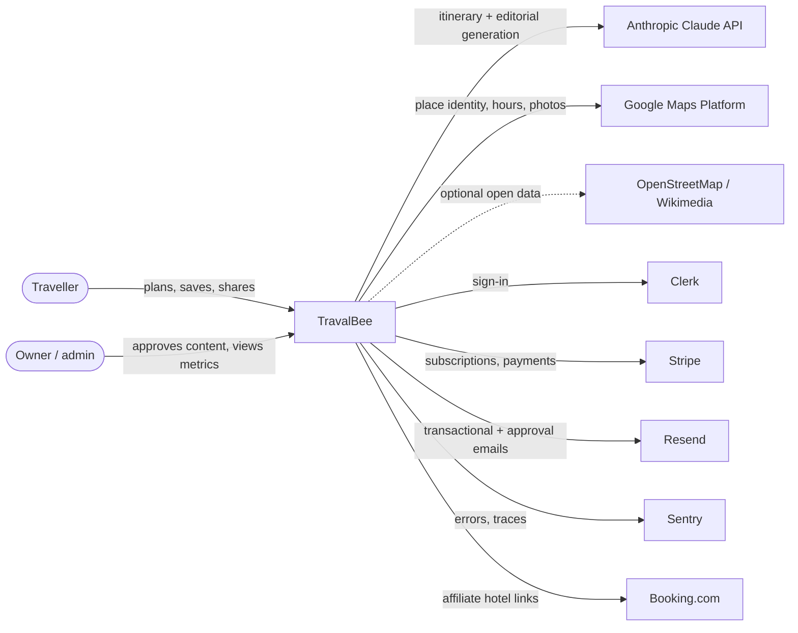
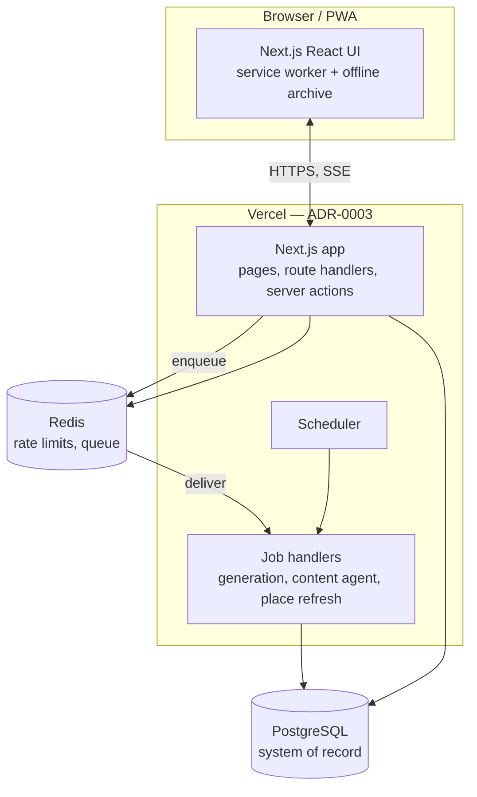
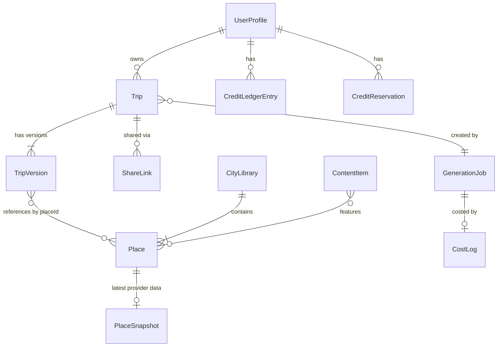

# TravalBee — Architecture

**Status:** Target architecture, proposed 2026-10-18. Describes where the system is going and how it gets there; the current state is summarised in §11.
**Decisions:** recorded as ADRs in [`docs/adr/`](docs/adr/README.md). This document describes the shape; the ADRs hold the reasoning and the alternatives.
**Backlog:** [`to-do.md`](to-do.md).

---

## 1. Purpose and scope

TravalBee generates multi-day city itineraries (activities and meals interleaved, with a map, opening hours, hotels and travel times) and lets travellers save, share and export them. This document covers the web application, its data, its integrations, and how it is built, tested, deployed and operated.

Out of scope: native mobile apps (the PWA covers mobile for now) and marketing operations.

## 2. Architectural drivers

### Business context
- Pre-traction: almost no users beyond friends and family. The architecture must make **fast product iteration** cheap and must not lock in decisions that only make sense at scale.
- Solo founder/operator: **operational load is a first-class cost**.
- Unit economics: each generated trip costs money (Claude + Google Places). Free trips are an acquisition cost, so **cost per trip** must be measured and controlled.

### Quality attribute priorities (in order)
| # | Attribute | Target / measure |
|---|---|---|
| 1 | **Correctness of places** | Every stop maps to a real, verified place ID; no invented coordinates |
| 2 | **Cost per trip** | Logged per generation; target set once the baseline is known (see to-do §0) |
| 3 | **Time to first value** | First day visible ≤ 15 s p75 from submit |
| 4 | **Operability** | No servers to patch; one-command deploy; rollback in minutes; errors alert |
| 5 | **Security & privacy** | No secrets client-side; private-by-default trips; least-privilege keys |
| 6 | **Portability** | Standard Postgres + portable Next.js; can move host without a rewrite |
| 7 | **Scalability** | Comfortable to 10k trips/month without redesign; known path beyond |

### Constraints
- TypeScript end to end; Next.js App Router (ADR-0002).
- Postgres as the system of record (ADR-0003).
- Third-party terms: Google Maps Platform limits what Places content may be stored (ADR-0007).
- Branding: no "AI" wording in user-facing copy.

## 3. System context



## 4. Containers



| Container | Responsibility | Technology |
|---|---|---|
| Web app | UI, route handlers, auth checks, reads, enqueueing jobs, streaming job progress | Next.js (App Router), React, Tailwind |
| Job handlers | Long-running or retryable work: trip generation, day regeneration, content drafts, place refresh | Same codebase, invoked by the queue (ADR-0004) |
| Scheduler | Cache cleanup, content agent runs, place refresh | Platform cron |
| PostgreSQL | All durable state | Supabase Postgres via Prisma (ADR-0003, ADR-0009) |
| Redis | Rate limiting, durable queue/workflow | Upstash Redis + QStash (ADR-0004) |

The web app and job handlers are **one deployable, one repository**. The split is logical (separate entry points), not separate services.

## 5. Code architecture — modular monolith

See ADR-0002. The codebase is organised by **business capability**, not by technical layer, with a strict dependency direction inside each module.

### Target layout
```
src/
├── app/                    # Next.js routes only — thin: parse → authorise → call module → render
├── ui/                     # Presentational React components, hooks, design tokens
├── shared/
│   └── contracts/          # Zod schemas + inferred types shared by client and server
└── server/                 # import "server-only" everywhere below this line
    ├── platform/           # Cross-cutting adapters: db, llm, cache, queue, email, logger, config, clock
    └── modules/
        ├── identity/       # Current user, roles (admin), Clerk webhook sync
        ├── planning/       # Generation + day regeneration: prompt building, validation, assembly
        ├── places/         # Place library, provider adapters (Google, OSM), enrichment, caching rules
        ├── trips/          # Trip aggregate, versions, edits, sharing
        ├── entitlements/   # Plans, quotas, credit ledger (reserve / commit / release)
        ├── billing/        # Stripe checkout, portal, webhooks → entitlement events
        ├── content/        # Trip ideas, seasonal picks: draft → approve → publish
        └── analytics/      # Cost logs, funnel events, admin metrics read models
```

Each module:
```
modules/<name>/
├── domain/          # Entities, value objects, pure rules — no I/O, no framework imports
├── application/     # Use cases (commands/queries); orchestrates domain + ports
├── infrastructure/  # Port implementations: Prisma repositories, provider clients
└── index.ts         # Public API — the ONLY file other modules may import
```

### Dependency rules (enforced in CI)
1. `app/` → `server/modules/*/index.ts`, `shared/`, `ui/`. Never `infrastructure/` directly.
2. A module imports another module **only through its `index.ts`**.
3. `domain/` imports nothing outside its own module except `shared/contracts`.
4. `ui/` and `shared/` never import `server/`.
5. Vendor SDKs (`@anthropic-ai/sdk`, `stripe`, Google, Prisma client) are imported only in `platform/` or a module's `infrastructure/`.

Enforced with `eslint-plugin-boundaries` (or `dependency-cruiser`) plus `import "server-only"`.

### Conventions
- **Validation at the edge:** every route handler and server action parses input with a contract from `shared/contracts`. Use cases receive typed, validated input.
- **Errors:** use cases return typed results for expected failures (`QuotaExceeded`, `PlaceNotFound`) and throw only for unexpected ones. Route handlers map results to HTTP status codes in one place.
- **Time and IDs** come from `platform/clock` and `platform/ids` so tests can control them.
- **No business logic in React components or route files.**

## 6. Domain modules

| Module | Owns (tables) | Key use cases | Depends on |
|---|---|---|---|
| identity | `UserProfile` (identity fields) | `getCurrentUser`, `requireAdmin`, sync from Clerk webhook | Clerk |
| entitlements | `Plan`, `CreditLedgerEntry`, `CreditReservation` | `reserveCredit`, `commitCredit`, `releaseCredit`, `getBalance`, `checkTripLimits` | identity |
| billing | `StripeEvent`, `Subscription` | `createCheckout`, `handleWebhook` (idempotent) → emits entitlement grants | entitlements |
| planning | `GenerationJob` | `startGeneration`, `regenerateDay`, `validateDay`, `assembleFromLibrary` | places, entitlements, platform/llm |
| places | `Place`, `PlaceSnapshot`, `CityLibrary` | `resolvePlace`, `enrichForDisplay`, `refreshStale`, `buildCityLibrary` | Google, OSM |
| trips | `Trip`, `TripVersion`, `ShareLink` | `saveTrip`, `applyEdit`, `undo`, `createShareLink`, `revokeShareLink`, `getForViewer` | planning, places |
| content | `ContentItem` | `draftTripIdeas`, `approve`, `reject`, `publish`, `listPublished` | planning, places, platform/llm, email |
| analytics | `CostLog`, `FunnelEvent` | `recordGenerationCost`, `recordEvent`, metrics queries | — |

## 7. Key flows

### 7.1 Generate a trip (ADR-0004, ADR-0005, ADR-0008)
```mermaid
sequenceDiagram
  participant U as Browser
  participant W as Web (route handler)
  participant E as entitlements
  participant Q as Queue
  participant J as Job: planning
  participant P as places
  participant L as LLM gateway
  participant D as Postgres
  U->>W: POST /api/generations (validated request, idempotency key)
  W->>E: reserveCredit(user|guest, key)
  E->>D: insert reservation (unique on key)
  W->>D: insert GenerationJob(status=queued)
  W->>Q: enqueue(jobId)
  W-->>U: 202 { jobId }
  U->>W: GET /api/generations/{jobId}/events (SSE)
  Q->>J: deliver(jobId)
  J->>P: candidate places for city (library or resolve)
  J->>L: structured generation (per day)
  L-->>J: day JSON (schema-valid)
  J->>J: validate route (distance, same city); regenerate failing day only
  J->>D: append day to job, emit progress
  W-->>U: event: day N ready
  J->>E: commitCredit(reservation)  (or releaseCredit on failure)
  J->>D: job status=done, CostLog row
  W-->>U: event: done
```

Properties: retries are safe (idempotency key + reservation), a closed browser tab does not lose the trip, refreshing reattaches to the same job, and failures release the credit.

### 7.2 Edit a trip (ADR-0006)
Local edits (delete, reorder, move between days, lock) are commands applied by `trips.applyEdit`, producing a new `TripVersion`. No LLM call. Undo = restore the previous version. "Regenerate this day" is a `planning.regenerateDay` job that respects locked stops and charges per the entitlement policy.

### 7.3 Purchase and renewal
Stripe Checkout → webhook → `billing.handleWebhook` deduplicates by Stripe event ID → emits `entitlements.grant(plan, period)` ledger entries. Balances are derived from the ledger; no page visit is required to reset quotas.

### 7.4 Content agent (ADR-0012)
Scheduler → `content.draftTripIdeas` job → LLM (with web research where needed) drafts items built from library places → saved as `pending` → approval email → owner approves/edits/rejects in `/admin/content` → `publish` makes it visible on the home page and its own crawlable page.

## 8. Data model (target)



| Table | Notes |
|---|---|
| `Trip` | Owner, destination, **original request (JSON, versioned contract)**, `currentVersionId`, timestamps |
| `TripVersion` | Immutable snapshot of the plan (days, stops by `placeId`, locks), parent version, change reason |
| `ShareLink` | Random token, created/revoked timestamps; public pages load by token only |
| `GenerationJob` | Status, request, progress (days produced), error type, idempotency key (unique) |
| `CreditLedgerEntry` | Append-only: grant / consume / expire / refund, amount, period, source |
| `CreditReservation` | Pending holds with expiry; committed → consume entry, released → deleted |
| `Place` | Our identity: `placeId` (provider), provider, city, our tags + description, coordinates per provider terms |
| `PlaceSnapshot` | Provider fields with fetch time and TTL (hours, rating, photo reference) |
| `CityLibrary` | Curated city set, status (draft/published), version |
| `ContentItem` | Type (trip idea / seasonal), body, sources, status (pending/approved/published/rejected), reviewer |
| `CostLog`, `FunnelEvent` | Analytics; append-only |

Existing `Trip.itineraryData` records are migrated by expand → backfill → contract (ADR-0009); the legacy `normalizeDayPlan()` shim stays until the backfill completes.

## 9. Cross-cutting concerns

### Security
- Secrets only in platform secret stores; nothing sensitive in `NEXT_PUBLIC_*`. The browser Maps key is referrer- and API-restricted; the server key never reaches the client (photos are proxied).
- Every use case authorises explicitly (owner, admin, or share token). IDOR protection is a repository rule: queries for user data always include the owner.
- Input validation on every boundary (Zod); LLM prompts take user text only inside delimited sections plus a fixed system prompt; LLM output is schema-validated before use.
- Webhooks verify signatures (Stripe, Clerk/Svix) and are idempotent.
- Rate limits per user and per IP on generation, photos and public endpoints.
- Dependency scanning and secret scanning in CI; quarterly key rotation runbook.
- Security headers as today; add a Content-Security-Policy in report-only mode first (Maps and Clerk need explicit allowances).

### Observability
- **Errors/traces:** Sentry (server, edge, client) with release tags from CI.
- **Structured logs:** JSON with `requestId`, `jobId`, `userId` (hashed), module, outcome. No PII or secrets.
- **Business metrics:** cost per trip (Claude vs Google), cache hit rate, time to first day, generation success rate, funnel conversion. Surfaced in `/admin/metrics`.
- **Alerts:** generation failure rate, error spikes, daily spend above threshold.

### Cost controls
- Per-trip cost logged from real usage (tokens, provider calls).
- LLM: one gateway, structured outputs, prompt caching, model per task, eval-gated model changes (ADR-0008).
- Places: library first, identity by place ID, snapshot TTLs, photo caching within provider terms (ADR-0007).
- Hard daily spend guard: generation is paused for free users if the daily budget is exceeded.

### Performance
- Streaming of job progress over SSE; first day rendered as soon as it is validated.
- Server components for read-heavy pages; client components only where interactive.
- Database indexes defined alongside each query pattern; N+1 checks in review.

### Offline / PWA
Service worker caches the app shell and photos; saved trips are mirrored locally for offline viewing. Edits made offline are not supported in v1 (read-only offline).

## 10. Environments and delivery

| Environment | Purpose | Data |
|---|---|---|
| Local | Development | Local Postgres (Docker) or a dev Supabase project; seeded fixtures |
| Preview | One per pull request | Shared staging database; Stripe and Clerk test modes |
| Production | travalbee.com | Production database; daily backups + point-in-time recovery |

### Pipeline (ADR-0010)
```
PR opened → typecheck → lint + boundary rules → unit tests → build → migrations dry-run
          → preview deploy → e2e smoke (Playwright) → review → merge to main
main      → production deploy → migrations (expand-only) → smoke → Sentry release
```
- `main` is protected: required checks, no direct pushes.
- Database changes follow expand → migrate → contract across separate releases (ADR-0009).
- Rollback: redeploy the previous build; migrations are backward-compatible by rule, so app rollback never requires a schema rollback.
- Platform configuration (projects, env var names, domains, cron) is declared as code (ADR-0011).

### Testing strategy
| Level | Scope | Tooling |
|---|---|---|
| Unit | Domain rules (route validation, ledger maths, edit commands, prompt building) | Vitest |
| Integration | Repositories and use cases against a real Postgres | Vitest + Testcontainers or a test database |
| Contract | Provider adapters against recorded fixtures (Stripe events, Places responses, LLM outputs) | Vitest |
| End to end | Plan → result → save → reopen → share; quota and paywall paths | Playwright |
| LLM evals | Spatial rules, schema validity, place validity, cost per trip across a fixed city set | Eval script, run on prompt/model changes |

## 11. Current state and migration path

### Current state (October 2026)
- Next.js 14 / React 18 / Clerk v6 on Vercel; Supabase Postgres via Prisma 5 (`db push`, no migration history); Upstash rate limiting; Sentry; Stripe; Resend.
- Two generation routes (`/api/itinerary` 1,159 lines, `/api/itinerary-stream` 777 lines) with duplicated prompt code; generation runs inside a long HTTP request (`maxDuration = 290`).
- Credits checked before and decremented after generation (not atomic); quota logic spread across routes and pages.
- Trips stored as a single JSON blob without original inputs or versions; shared pages load any trip by UUID.
- Places resolved per trip from the model's spelling of names; cache keyed by normalised name.
- Type and lint checks disabled in builds; no automated tests; no CI.

### Migration (strangler pattern, each phase shippable)
| Phase | Outcome | ADRs |
|---|---|---|
| 0. Foundations | Strict TS + lint on; CI pipeline; Vitest + Playwright harness; `prisma migrate` baseline; Next.js + Clerk upgrade; leaked-key fix and rotation | 0002, 0009, 0010, 0011 |
| 1. Consolidate generation | `platform/llm` gateway; `planning` module; job-based generation; entitlement ledger; legacy route retired | 0004, 0005, 0008 |
| 2. Trip aggregate | `Trip` + `TripVersion` + `ShareLink`; edits and undo; backfill of existing trips | 0006, 0009 |
| 3. Places | `places` module; place-ID identity; city libraries for launch cities; Places API (New) | 0007 |
| 4. Growth surfaces | Home-page quick planner; trip ideas + seasonal picks; content agent with approval | 0012 |

## 12. Decision log
See [`docs/adr/README.md`](docs/adr/README.md).
